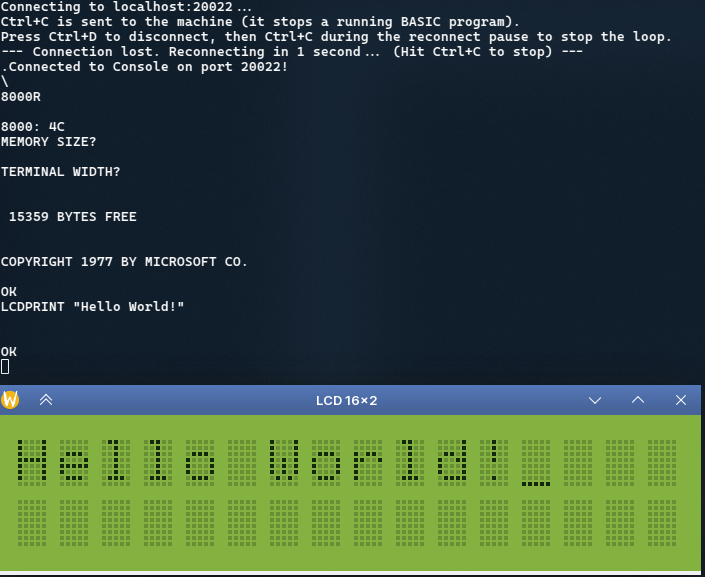

# WireSim

WireSim is a wire-level, logic-level digital logic simulator for building 8-bit computers and devices entirely in software, without the hassle of real hardware. Chips are modelled as devices with real pins, pins are joined into nets, and the simulation advances in half clock cycles. Change a line of assembly, rebuild, and watch the whole machine run the new code within seconds.

## Why this exists

This project is a breadboard for software engineers, as opposed to hardware engineers. Building a retro 8-bit computer on a real breadboard is slow: wiring mistakes are hard to see, signals can only be probed one at a time, and every firmware change means reprogramming a chip. WireSim aims to give hardware tinkering the same fast, observable, repeatable feedback loop that software engineers are used to.

The simulation is deliberately close to real hardware. Devices expose the same pins as the chips they model, buses can float or fight (contention is a first-class logic state), and glue logic is written as address decoding on real signals. Once a computer works in the simulator, the assembled binaries and the wiring definitions are enough to build the same computer physically. The goal is to do the debugging and feature work here, with extremely fast turnaround, before going fully into the hardware.

## How it came to be

The author is a C# developer. The first version of the simulator, including a 6502 CPU and a 16C550 UART, was written entirely in C#. Experiments with C++ showed a potential of roughly twice the simulation speed, so the whole thing was redeveloped in C++. C# feels like a sweet language to work in, and C++ feels bitter, so this repository leans on Claude Code for the C++ work. It ships a set of skills and instructions (in `.claude/` and `AGENTS.md`) that let Claude build devices and machines from specifications and datasheets alone.

## What is in the box

The code is split into three layers:

- **Simulator** (`src/Simulator/`): the generic netlist and event engine. See [overview.md](overview.md) for pins, nets, the six logic states (`H`, `L`, `Hw`, `Lw`, `F`, `E`) and the two-phase simulation cycle.
- **Devices** (`src/Devices/`): reusable, machine-agnostic hardware such as the W65C02 CPU, W65C22 VIA, W65C51N ACIA, ST16C550 UART, HD44780 LCD controller, SRAM and EEPROM. Each device has documentation next to its code and is verified on its own with `DeviceHarness`, without a CPU, ROM or machine.
- **Machines** (`src/Machines/`): complete computers assembled from devices, glue logic and firmware. They are verified with `MachineHarness`, which boots a machine headless from a ROM image and checks CPU and memory state.

Datasheets for the chips modelled here are in [docs/](docs/).

### Machines

**BenEater6502** is a model of Ben Eater's breadboard 6502 computer. It runs Microsoft BASIC and WozMon from the vendored [msbasic](https://github.com/beneater/msbasic) submodule and has a W65C22 VIA, a W65C51N ACIA bridged to a TCP port as the serial console, an HD44780 LCD and 16 KiB of SRAM. Its memory map, wiring and quirks are described in [src/Machines/BenEater6502/AGENTS.md](src/Machines/BenEater6502/AGENTS.md).

### Experimental devices

The repository also contains experimental devices that are simply playgrounds for the author, for example the MRDI-1 monochrome raster display interface ([src/Devices/Graphics/Mrdi1/Mrdi1.md](src/Devices/Graphics/Mrdi1/Mrdi1.md)). They are not part of any reference machine.

### Sync and async bus devices

Peripherals fall into two groups, and the difference matters a lot for simulation cost.

- **Async bus devices**, such as the ST16C550 UART, have no clock input on their CPU-facing bus. They react only to strobes and chip selects, so most of the time they can sleep and cost nothing during the simulation cycles in which nothing addresses them.
- **Sync bus devices**, such as the W65C51N ACIA, take the system clock as an input. They are woken on every clock signal change, whether or not anything useful happens, so they are more expensive to simulate.

Performance is the main concern of the engine, and this is why. Commit messages record the measured half-cycle rate.

## How devices and machines are created today

New hardware is added in two steps, each driven by a project skill in `.claude/skills/` and verified by its own harness. The rules those skills follow live in [AGENTS.md](AGENTS.md).

1. **Devices from datasheets.** Give Claude a datasheet (the PDFs in [docs/](docs/) are examples) and ask for the chip. The `device-cpp` skill writes it as a C++ `Sim::Device`, or `device-verilog` writes it as Verilog that is verilated and wrapped as a device. The `device-harness` skill then exercises the device through its pins with a `.devtest` script, with no CPU, ROM or machine involved. A device is considered done when its script passes. The `device-inspect` skill can add opt-in register and memory inspection so tests can read the device's state afterwards.
2. **Machines from specifications.** Give Claude a specification of the computer, such as the component list, memory map, clock and reset topology and firmware toolchain (see [src/Machines/BenEater6502/specs/specification.md](src/Machines/BenEater6502/specs/specification.md) for an example). The `machine-engineer` skill wires already verified devices together with address-decode glue logic and firmware, and verifies the result with a `.machinetest` booted through `MachineHarness`.

For debugging, the `asm-test` skill runs a small 65C02 assembly program and reads back the trace and final CPU state. Debugging agents in `.claude/agents/` cover problems at the register level of a single device and in the wiring between chips.

## Getting started

### Option 1: VS Code with the dev container

The dev container provides the full toolchain (clang, CMake, Ninja, Verilator, cc65, SDL2, gdb) so nothing needs to be installed on the host.

Requirements on the host:

- VS Code with the Dev Containers extension.
- Podman (the workspace settings point `dev.containers.dockerPath` at `podman`). Docker needs that setting changed.
- A Linux host with Wayland or X11 if you want the SDL windows (for example the LCD). The display sockets are bind-mounted into the container. Details and troubleshooting are in [.devcontainer/README.md](.devcontainer/README.md).

Steps:

1. Clone the repository and fetch the BASIC sources: `git clone <url>` then `git submodule update --init`.
2. Open the folder in VS Code and run **Dev Containers: Reopen in Container**. The first build of the image takes a while.
3. Open the CMake Tools panel in the status bar. Choose the `debug` or `release` configure preset (use `release` for speed).
4. Select `BenEater6502` as the launch target and press **Build**.
5. Press the **Run** button to start the machine, or the **Debug** button to run it under gdb with C++ breakpoints.
6. Open a terminal in VS Code and connect to the serial console (see [Using BenEater6502](#using-beneater6502) below).

### Option 2: Command line

Install the toolchain on the host: `clang++` (C++23), CMake 3.20 or newer, Ninja or Make, `verilator`, `ca65`/`ld65` from cc65, and the SDL2 development headers (on Fedora: `sdl2-compat-devel`). `socat` is needed for the console helper script.

```bash
git submodule update --init                     # fetch msbasic, once
cmake --preset release                          # configure, once and after adding files
cmake --build --preset release                  # simulator, harnesses and all firmware
cmake --build --preset release --target check   # run every device and machine test
```

Use the `debug` preset instead of `release` when you want to step through the C++ code. Builds land in `build/<preset>/`, and the assembled firmware goes to `build/<preset>/rom/`.

## Using BenEater6502

BenEater6502 is meant to be used interactively. You need two terminals: one runs the simulator and takes its control keys, the other is the serial console of the simulated computer. In VS Code, open a second integrated terminal for the console.

### 1. Start the simulator

In the first terminal:

```bash
build/release/BenEater6502
```

The simulated computer boots and runs until you quit it. Leave this terminal focused: each key you press here is a command to the simulator, with no Enter needed.

| Key | Action |
| --- | --- |
| `q` | quit the simulator |
| `r` | reset the computer (like pressing a reset button) |
| `d` | open the LCD window |
| `s` | print status: CPU registers, cycle counts and the current simulation speed |
| `v` | toggle verbose diagnostics (very slow and very noisy, so use it briefly) |

In VS Code you can also start it with the CMake Tools **Run** button (or **Debug** for breakpoints in the C++ code), and then focus the terminal it opens to send keys.

### 2. Connect to the serial console

The computer's serial port (the W65C51N ACIA) is exposed as a TCP server on port 20022. In the second terminal:

```bash
./connect.sh 20022
```

`connect.sh` keeps reconnecting if the simulator restarts. Ctrl+C is sent to the computer (it stops a running BASIC program) and Ctrl+D disconnects. If you prefer, `socat - TCP:localhost:20022` works as a plain connection.

### 3. Talk to the computer

After a reset the computer lands in WozMon at its `\` prompt. Type `8000R` and press Enter to start Microsoft BASIC, then press Enter twice to answer `MEMORY SIZE?` and `TERMINAL WIDTH?`. From there it behaves like any 1980s BASIC: type `10 PRINT "HELLO"` and `RUN` it.

This build of BASIC also has commands for the hardware on the board:

- `LCDCMD n` sends a command byte to the LCD.
- `LCDPRINT expr` prints to the LCD (press `d` in the simulator terminal first to see the LCD window).
- `BEEP freq,duration` drives the piezo.



Backspace does not delete in the BASIC line editor, because the original firmware ignores it. Type `_` to delete the previous character instead.

### Options

- `--variant NAME`: pick a firmware variant built under `build/<preset>/rom/BenEater6502-NAME` (default is `basic`).
- `--rom DIR`: load a hand-built ROM directory instead.
- `--cycles N`: stop by itself after N CPU cycles, which is handy for scripted runs.

The simulator can be started from any directory.

## Writing your own firmware

The fast loop this project exists for is: edit assembly, rebuild, run. Firmware is assembled with ca65 and linked with ld65 by CMake, so a normal `cmake --build --preset release` picks up changes, and re-launching `BenEater6502` boots the new image. The BenEater6502 firmware sources are in `src/Machines/BenEater6502/Firmware/`, and `src/Machines/BenEater6502/scripts/build-firmware.sh -o DIR` builds a firmware directory by hand that you can pass to `--rom`.

## Testing

- **Devices**: each device may ship a `.devtest` script that drives its pins directly through `DeviceHarness` ([src/Testing/DeviceHarness.md](src/Testing/DeviceHarness.md)).
- **Machines**: a `.machinetest` script boots a machine from a pre-built ROM headless and asserts CPU and memory state through `MachineHarness` ([src/Testing/MachineHarness.md](src/Testing/MachineHarness.md)).
- Run all of them with `cmake --build --preset release --target check`.

## Further reading

- [overview.md](overview.md): how the simulator core works.
- [AGENTS.md](AGENTS.md): repository map, coding conventions and contributor workflow rules (written for coding agents, useful for humans too).
- [.devcontainer/README.md](.devcontainer/README.md): display passthrough, GPU and Podman notes for the dev container.
